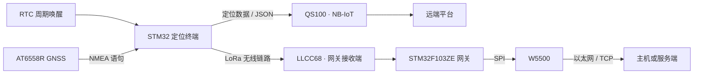

# 低功耗 GNSS 定位与多链路物联网终端

基于 STM32F103 的周期定位与数据上报系统。架构分为**定位终端**和**以太网网关**：终端负责唤醒、获取坐标与封装数据；上报既可采用 NB-IoT 直连，也可经 LoRa 接入本地网关，再由网关转至以太网。两条路径是不同的接入方案，不代表固件会自动切换链路。

**当前仓库提供网关侧 Keil 工程。** 默认入口运行 W5500 TCP 客户端示例；同一入口保留了可单独启用的 LLCC68 接收示例。下图描述系统架构，不表示默认固件已经串通整条转发链路。

## 系统架构

### 终端：按工作周期组织定位与上报

- **定位采集：** 从 AT6558R 输出的 NMEA 语句中提取定位信息，在设备侧生成结构化数据；蜂窝上报路径使用 cJSON 封装，而不是将原始串口报文直接交给平台。
- **低功耗调度：** 以“RTC 唤醒 → 采集定位 → 上报 → 返回 STOP”为一个工作周期，使 MCU 在两次采集之间休眠。这里描述的是调度策略，不以未测量的电流或续航作为指标。
- **链路分工：** 经 QS100 上报时，终端直接接入蜂窝网络；经 LoRa 上报时，终端只负责无线段，由本地网关承担以太网出口。

### 网关：无线接收与以太网发送分别调试

| 模块 | 源码中的实现 | 默认运行状态 |
| --- | --- | --- |
| [应用入口](MDK-ARM/source/App/App_Main.c) | 选择测试路径并组织主循环 | 启用 W5500 发送 |
| [LoRa 接口](MDK-ARM/source/Int/LLCC68/Int_LLCC68.c) | 封装 LLCC68 初始化与接收；入口示例轮询接收缓冲并从串口打印 | 接收示例已注释，可单独启用 |
| [以太网接口](MDK-ARM/source/Int/W5500/Int_W5500.c) | 配置静态网络参数，按 Socket 状态创建 TCP 客户端、建立连接、发送并关闭 | 每轮发送固定的 3 字节测试载荷 `sgg` |

**当前示例发送的是测试数据，不是经纬度。** 若要运行完整网关转发，需要把 LLCC68 实际接收到的缓冲区和有效长度传给以太网发送接口，而不是只取消接收示例的注释。

## 构建与验证网关

1. 使用 Keil MDK5 打开 [网关工程](MDK-ARM/atguigu-project-location-gateway.uvprojx)，确认已安装 STM32F1 系列器件支持包。
2. 在 [W5500 配置](MDK-ARM/source/Int/W5500/Int_W5500.c)中按实际局域网设置设备地址、网关与服务器地址。源码默认设备地址为 `192.168.45.120/24`，TCP 目标为 `192.168.45.20:777`。
3. 在目标主机启动 TCP 监听，再编译并烧录网关固件。正常连通时，主机应收到 `sgg`；网关发送后关闭连接，主循环等待 3 秒再进入下一轮。以服务端实际收包为验证依据。
4. 如需单测无线段，在应用入口切换至 LLCC68 初始化与接收示例，并使用无线参数一致的 LoRa 发送端。此时先通过串口核对接收内容，不依赖以太网服务端。
