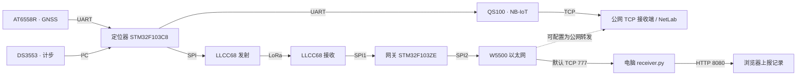
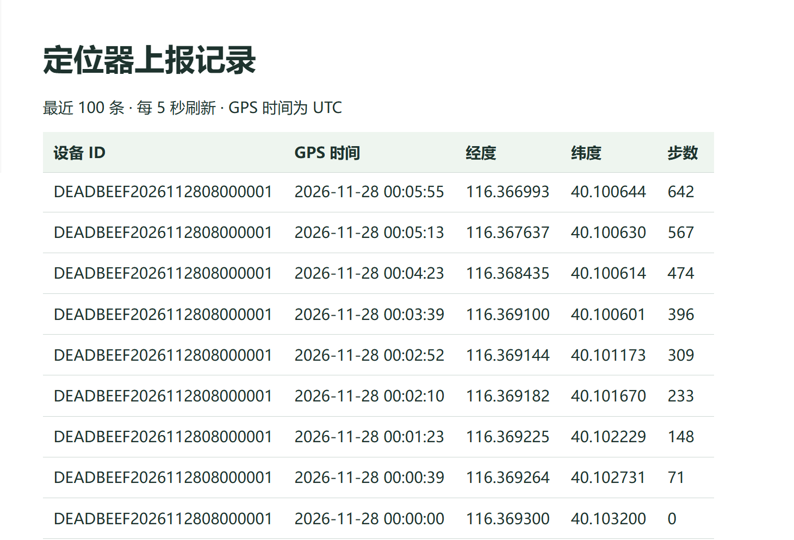

# STM32 低功耗畜牧定位器

定位器读取 AT6558R 的卫星定位数据和 DS3553 的累计步数。默认配置通过 LoRa 发给以太网网关，再由电脑上的接收程序显示最近的上报记录。配置公网 TCP 服务后，定位器优先走 NB-IoT，上报失败时尝试 LoRa。

## 系统架构



定位器校验 RMC 报文和定位状态后，使用芯片 UID、UTC 时间、经纬度和累计步数组装一条换行分隔的 JSON。单条记录可放入一个 LoRa 包。网关按实际收到的字节数转发。定位器完成一轮工作后设置 RTC 闹钟并进入待机，默认 30 秒后唤醒。搜星和通信也需要时间，因此实际两次上报之间通常超过 30 秒。

## 工程入口

| 内容 | 入口 |
|---|---|
| 定位器固件（STM32F103C8） | [tracker Keil 工程](tracker/MDK-ARM/atguigu-project-location-gps.uvprojx) |
| 网关固件（STM32F103ZE） | [gateway Keil 工程](gateway/MDK-ARM/atguigu-project-location-gateway.uvprojx) |
| 双板共享网络配置和采集周期 | [Link_Config.h](Link_Config.h) |
| TCP 接收和 HTTP 展示 | [receiver.py](receiver.py)，Python 3.8 或以上，仅使用标准库 |

## 局域网联调

1. 将 W5500 与接收电脑接入同一局域网。在根目录的 `Link_Config.h` 中，把 `LAN_SERVER_IPV4` 改为电脑的 IPv4，给网关板的 `GATEWAY_IPV4` 分配独立地址，并填写现场的 `ROUTER_IPV4` 和 `SUBNET_MASK`。IPv4 宏用逗号分隔四个十进制数。示例默认电脑为 `192.168.45.20`，网关板为 `192.168.45.120`。
2. 在仓库根目录运行 `python receiver.py`，允许网关访问电脑的 TCP 777 端口，然后在这台电脑上打开 [本地展示页面](http://127.0.0.1:8080/)。页面每 5 秒刷新一次。若固件修改了接收端口，用 `--tcp-port` 给接收程序指定相同的值。
3. 安装 Keil MDK、工程所用的 Arm Compiler 5 和 STM32F1 设备支持包。在上表对应工程中分别执行 Rebuild，核对板上的 MCU 型号后烧录。保留根目录和两个工程的相对路径，以便编译时找到共享配置。
4. 先启动接收端和网关，再给定位器上电，将 GNSS 天线放在能收到卫星信号的位置。两块板的调试串口都是 USART1、115200 波特。网关出现 `LoRa RX` 表示收到无线包，`TCP: forwarded` 表示 W5500 确认发送。验收时移动同一台定位器，比较页面上两条记录的时间和坐标。
5. 同一可信局域网中的手机也可以查看。用 `python receiver.py --web-bind 0.0.0.0` 启动，在手机浏览器输入电脑的局域网 IP 和 8080 端口，并允许该端口的局域网入站连接。接收器在内存中保留最近 100 条，重启后清空。

## NB-IoT 直传与 LoRa 回退

默认 `CLOUD_PORT=0`，定位器直接走 LoRa。测试 NB-IoT 时，在合宙 NetLab 中打开 TCP，把该次监听的地址和端口写入 `CLOUD_IPV4`、`CLOUD_PORT`，重新编译并烧录定位器。QS100 在附网、连接、发送或发送确认失败时尝试 LoRa。若要让网关也发往同一个公网接收端，把 `GATEWAY_USE_CLOUD` 改为 1，确认网关能访问公网后重编网关固件。直传数据在公网接收端查看，本地页面显示发往本地 TCP 接收器的记录。[NetLab 使用说明](https://docs.openluat.com/common/TCPUDP_Test/)

## 上报格式和展示

```json
{"id":"DEADBEEF2026112808000001","lon":116.369300,"lat":40.103200,"date":"2026-11-28 00:00:00","step":0}
```

设备发送 UTF-8 兼容的 ASCII JSON，每条结尾带换行。经纬度使用十进制度，南纬和西经取负值。`date` 来自 GPS，使用 UTC，示例时间对应北京时间 08:00。`step` 是累计步数，读取失败时发送 `null`，页面显示「—」。默认等待有效定位最长 120 秒，超时后跳过本轮。网络故障可能导致丢报或重复上报，接收器合并最近记录中内容相同的重复项。当前版本没有离线补传。

下图使用模拟步行数据展示页面字段和降序排列效果。



## 验证范围

已在本机用 Keil 重建局域网和公网配置的两套固件，并用模拟 UART 输入验证 RMC 解析、南纬和西经处理、无效定位过滤、NB-IoT 成功分支及 LoRa 回退分支。本地 TCP 收包、分段与连续记录处理、重复记录合并和浏览器展示已通过软件联调。卫星搜星、SIM 附网、LoRa 空口、W5500 实物转发、RTC 唤醒和功耗仍需在对应板卡上验收。
